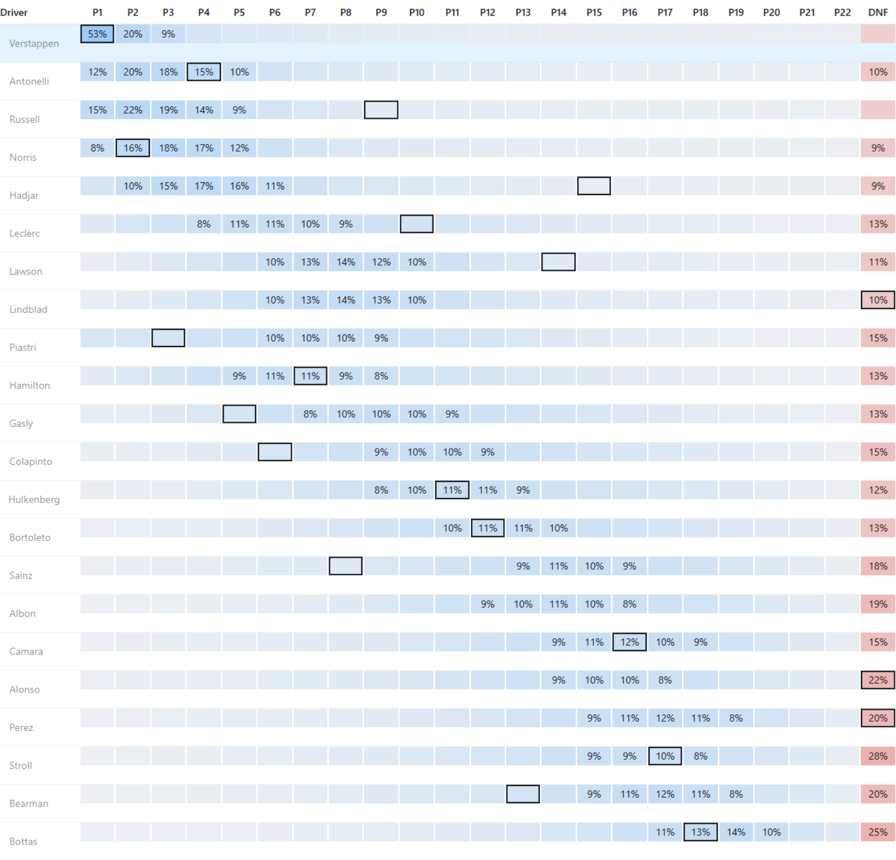

# Let’s build an ML model to predict the Las Vegas GP winner

This project forecasts the **2026 Las Vegas Grand Prix** from two cutoffs, before the weekend and after qualifying. It includes a race-winner model, a finishing-position model, and a simulator that produces a probability for every driver and finish from P1 to P22, plus DNF. The post-race audit scores the frozen forecasts against the FIA final classification.

**Max Verstappen was the simulator’s pre-race favorite at 53.30%. He won.**

[Interactive dashboard](dashboard/index.html) · [Post-race report](reports/2026-las-vegas-post-race.pdf) · [LinkedIn carousel](reports/2026-las-vegas-post-race-carousel.pdf)

Download or clone the repository and open `dashboard/index.html` in a browser for the interactive views. The dashboard is self-contained and works offline.



## Vegas post-race scorecard

| Measure | Result |
| --- | --- |
| Winner | Verstappen was the top pick and finished P1 |
| Podium | 1 of the model’s 3 most likely podium picks finished on the podium |
| Points | 7 of the model’s 10 most likely points scorers scored |
| Retirement count | 3.05 expected across the 21 actual starters, compared with 3 observed |
| Finishing position | 3.09 places mean absolute error across 18 finishers, compared with 4.50 for starting grid |

Expected retirements are the sum of driver-level DNF probabilities. The entrant who did not start is shown separately in the race audit.

## Models and inputs

| Model | Outputs and inputs |
| --- | --- |
| Pre-weekend winner and ridge finish models | Win odds and estimated finish using information available before practice, including driver and team form |
| Post-qualifying **L2-regularized logistic winner model** | Race-normalized win odds using the starting grid, qualifying, practice and driver and constructor form. The v2 experiments add cleaned practice long runs, recent driver and constructor race pace, and recent DNF rates, with temperature scaling fitted on earlier out-of-sample races. |
| **Ridge regression** | A numeric finishing-position estimate and standardized feature coefficients. The simulator uses its own ridge fit for pace conditional on finishing. |
| **Logistic retirement model and Monte Carlo finishing-order simulator** | DNF probability per driver, plus win, podium, top-10 odds and the full finishing-position distribution from 50,000 joint race draws. The simulator samples pace residuals from prior out-of-sample races. |

Practice long-run and recent race-pace features are constructed from cleaned lap and stint data. The post-qualifying model includes driver and constructor form. The dashboard and report include a pre-race weather forecast for context. Weather is not fitted as a predictor in the archived simulator.

## Rolling backtest

The snapshot contains 90 historical races from 2023–2026. The rolling backtest scores 52 races from Baku 2024 through São Paulo 2026, with 1,052 eligible driver-race entries for the simulator. Each scored block uses only earlier races for training and calibration. Las Vegas serves as the separate post-race case study.

| Simulation outcome | Model Brier | Baseline Brier |
| --- | ---: | ---: |
| Podium | 0.06628 | 0.06792 |
| Top 10 | 0.14712 | 0.16178 |
| DNF | 0.11945 | 0.12220 |

Lower Brier scores are better. Podium and top-10 comparisons use a grid-based simulator. DNF uses a rolling historical rate. For **winner probabilities**, the current uncalibrated baseline had the best log loss of the three main variants (1.156 versus 1.195 for calibrated full v2 and 1.274 for raw grid-only). Grid-only picked more winners outright (34 of 52 versus 30 for current and 32 for full v2). One correct Vegas forecast is a case study. Use the [rolling results](artifacts/feature_comparison/REPORT.md) and [retirement recalibration experiment](artifacts/simulation/dnf_recalibration_experiment.json) to assess repeat performance.

## Reproduce the results

Run from the repository root with **Python 3.10+**. The offline commands use the standard library and the included engineered data snapshot. They write to `runs/` so the published forecasts and checks remain reproducible.

```sh
python -m lasvegas_ml audit
python -m lasvegas_ml simulate
python -m lasvegas_ml train-winner
python -m lasvegas_ml compare-features
python -m lasvegas_ml test-dnf-calibration
```

Start with `audit` to reproduce the Vegas scorecard. `simulate` refits the pace and retirement models, replays the historical blocks, and regenerates the post-qualifying Vegas finishing distribution. The two winner commands retrain the models and feature comparisons. `test-dnf-calibration` reproduces the experiment that was evaluated after Vegas and kept separate from the locked forecast.

The optional `python -m lasvegas_ml download` command fetches the original timing and classification inputs from OpenF1, subject to its availability and rate limits. Raw caches can be large. The offline commands always use the included snapshot. The source pipeline for rebuilding features from downloaded inputs is `build_dataset()` in [`lasvegas_ml/v2/training.py`](lasvegas_ml/v2/training.py).

## Repository layout

| Path | Contents |
| --- | --- |
| [`lasvegas_ml/`](lasvegas_ml/) | Data cleaning, baselines, winner training, finish simulation and auditing |
| [`data/`](data/) | Engineered input snapshot, official grid and final classification |
| [`artifacts/`](artifacts/) | Frozen forecasts, model parameters, coefficients, feature experiments and rolling scores |
| [`dashboard/`](dashboard/) | Interactive race forecast and post-race dashboard |
| [`reports/`](reports/) | Research report, heatmap and two-page presentation for sharing |

## Sources and attribution

Timing, roster and historical result inputs come from [OpenF1](https://openf1.org/). The Vegas grid comes from [Formula 1](https://www.formula1.com/en/results/2026/races/1300/las-vegas/starting-grid). The final classification comes from [FIA decision document 65](https://www.fia.com/system/files/decision-document/2026_las_vegas_grand_prix_-_final_race_classification.pdf). [Mariana Antaya’s F1 race-prediction work](https://www.linkedin.com/in/marianaantaya/) inspired the project.
